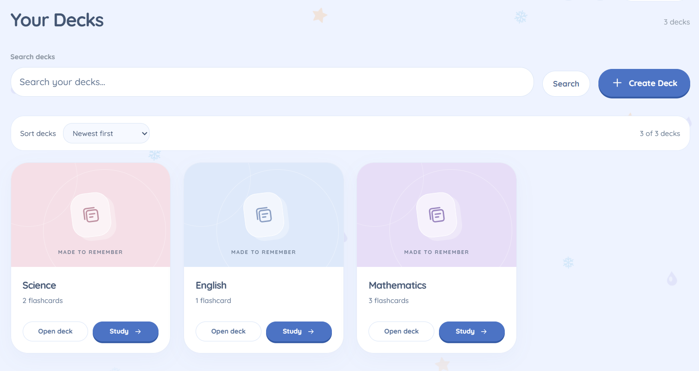
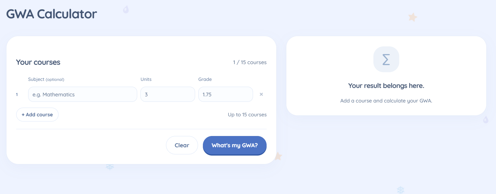
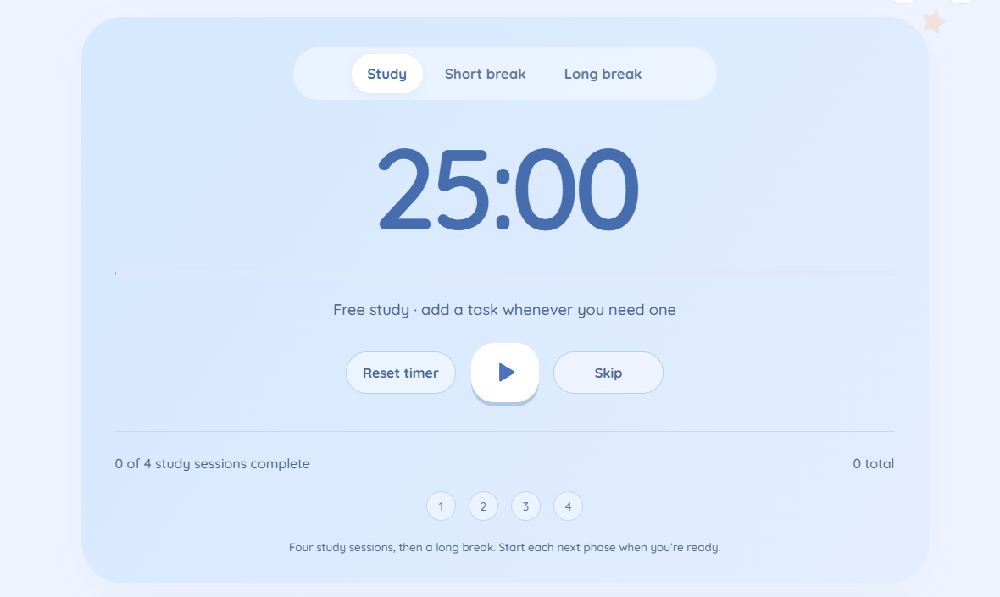

# Queezo

**Study with flashcards, calculate your GWA, and make time to focus.**


Queezo is a study workspace for students. Build your own decks, discover decks shared by other students, check a unit-weighted grade average, and work through a task list with a Pomodoro timer. The app runs locally with Docker Compose.

## What you can do

| App | Features |
| --- | --- |
| **Flashcards** | Create and organize two-sided cards with photos and lists. Use Classic Mode for timed or unlimited recall practice, or Multiple-Choice Mode for four-option questions with local Ollama generation, same-deck fallback, and server grading. |
| **GWA Calculator** | Calculate `sum(grade × units) / sum(units)` for 1–15 courses on a 1.00–5.00 scale. Subject names are optional. Enter `175` as shorthand for `1.75`. Results include a classification and a grade-scale bar. Calculations are stateless. |
| **Pomodoro Timer** | Customize study and break lengths, set study targets for tasks, and see alerts when intervals or tasks finish. The default is four 25-minute study sessions with three 5-minute breaks and a 15-minute long break. Each new phase waits for you to start it. |

Decks default to **Private**. **Public** decks appear in Community Decks on Home, which shows up to 20 recent decks, and on the owner's profile. **Unlisted** decks are accessible by share link. Sharing requires sign-in, and readers can save an independent private copy. The deck editor requires a question and answer and rejects URLs in titles and card text.

Rated flashcards and completed study intervals count toward streaks using Asia/Manila calendar days. Profile shows your total decks and longest streak. Pomodoro settings and tasks stay in the current browser under your account. In-app alerts work while Queezo is open, and desktop alerts require browser permission.

Open **Friends** from the top bar to search your list, send requests by username, and view a friend’s public profile. Friends appear online when Queezo has recently been open in an active tab. Study invitations, email verification, and password recovery are unavailable.

## Getting started

Install and start [Docker Desktop](https://docs.docker.com/desktop/) with Linux containers, or use Docker Engine with the Compose plugin.

From the repository root, run:

```sh
docker compose up -d --build --wait
```

Or to enter dev mode, run:
```sh
docker compose -f compose.yaml -f compose.dev.yaml up --build
```

Open [Queezo on localhost](http://localhost:8080) and choose **Create an account**.
If you are in dev mode, click this: [Open Queezo on Developer mode](http://localhost:5173)

For custom settings, copy [`.env.example`](.env.example) to `.env`. Set `AUTH_TRUSTED_ORIGINS` to the exact browser origins, including the port, if you change `APP_PORT` or the hostname. See the [account setup guide](AUTH_SETUP.md#environment-configuration) for HTTPS settings.


You can also create an account from an interactive terminal:
```powershell
docker compose exec backend python -m app.cli create-user <name>
```

The CLI also supports listing and inspecting users, revoking sessions, deleting accounts, and assigning legacy decks. See the [CLI and legacy ownership instructions](AUTH_SETUP.md).

## Tech stack and project structure

| Path | Role |
| --- | --- |
| [`frontend/`](frontend/) | Vue 3, Vue Router, and Vite. Includes all views, shared components, existing styles, public assets, and frontend tests. |
| [`backend/app/`](backend/app/) | Python 3.12 and FastAPI for accounts, flashcards, sharing, study sessions, and activity. |
| [`backend/app/gwa/`](backend/app/gwa/) | Separate FastAPI service for decimal-based GWA calculations. |
| [`backend/tests/`](backend/tests/) | Pytest coverage for API behavior, accounts, persistence, and migrations. |
| [`nginx/`](nginx/) and [`compose.yaml`](compose.yaml) | The frontend image builds with Node and Vite. Nginx serves the build and proxies both APIs. Compose runs the three services. |

Both APIs use SQLAlchemy and a shared SQLite database for account and session validation. The Compose database is stored in the `queezo_data` volume. `docker compose down` keeps it. **`docker compose down -v` deletes it.**

## Screenshots

### Flashcards

Search or sort your decks, then open one to edit or start studying.



### GWA Calculator

Enter each course’s units and grade to calculate your weighted average.



### Pomodoro Timer

Start a focus session and track your progress through the study and break cycle.



## Documentation

- [Software architecture](docs/architecture/README.md).
- Local API references for [Flashcards and accounts](http://localhost:8080/docs) and [GWA](http://localhost:8080/gwa/docs). Health endpoints are `/api/health` and `/api/gwa/health`.
- [Account setup and troubleshooting](AUTH_SETUP.md) and [authentication implementation](AUTH_IMPLEMENTATION.md).
- [Local Ollama generation and SQLite caching for Multiple-Choice Mode](docs/OLLAMA.md).
- [Multiplayer Study Rooms](docs/STUDY_ROOMS.md).
- [Multiple-choice study API and preparation lifecycle](docs/MULTIPLE_CHOICE.md).
- [Vue development and migration verification](docs/VUE_MIGRATION.md).
- [Verification history](VERIFICATION.md) and [visual asset attribution](frontend/public/assets/README.md).

