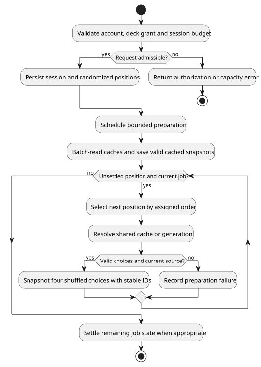
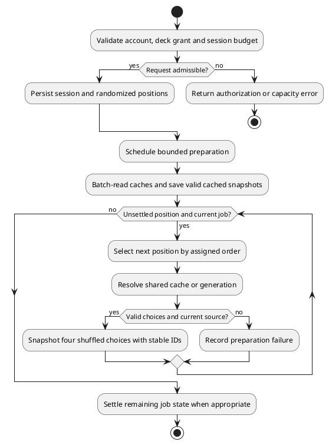
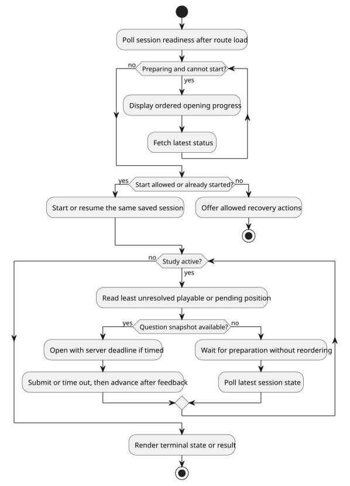
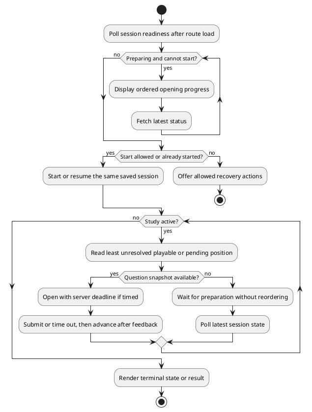
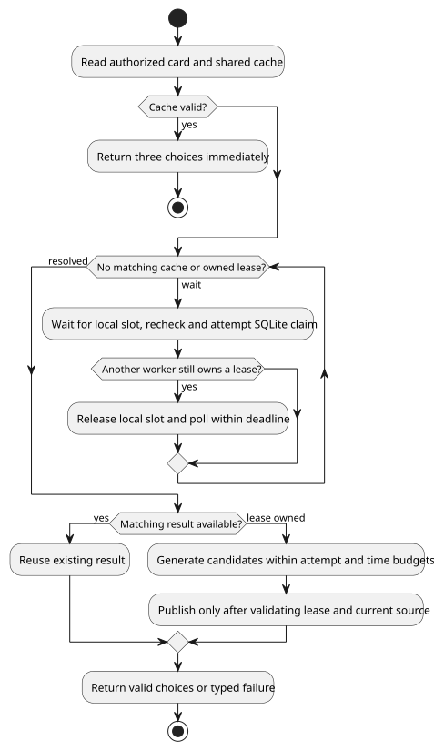
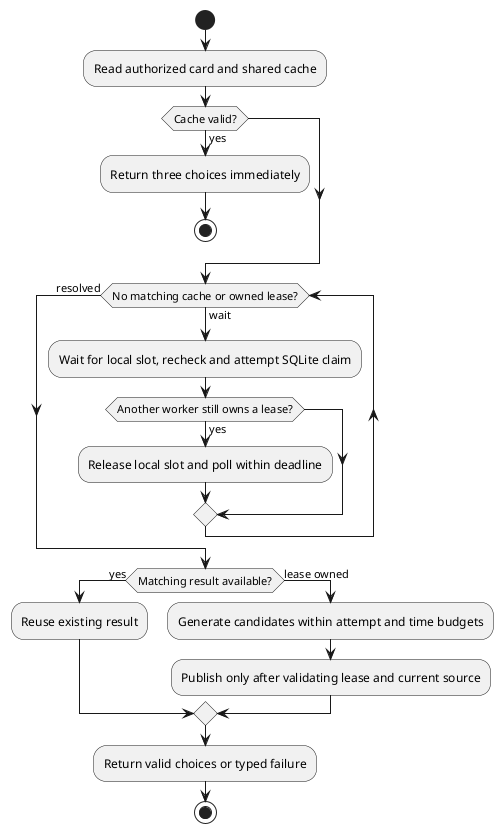
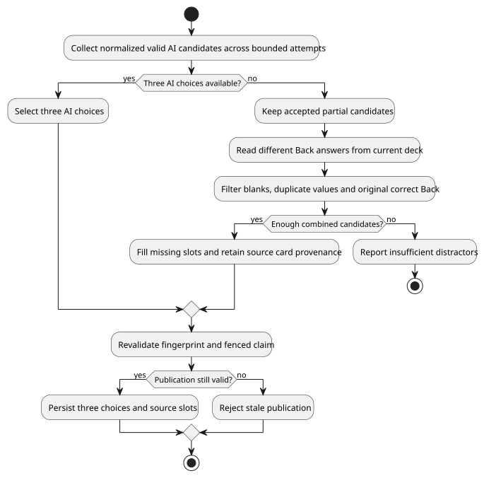
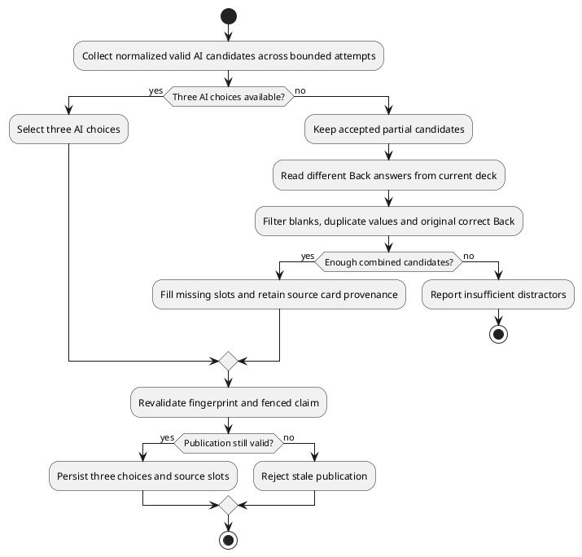

# Activity diagrams · Multiple-Choice preparation

[Architecture index](../../README.md) · [Flashcards and AI](../../05-flashcards-and-ai.md)

## Multiple-Choice preparation

Batch cache reads and early writes reduce repeated lookups. The queue carries session and attempt identities. Stale or cancelled jobs cannot publish into a newer attempt. A snapshot owns its option IDs even after the source is edited.

Sources [preparation API](../../../../backend/app/routers/multiple_choice.py), [worker and cache batch](../../../../backend/app/services/multiple_choice.py).

## Progressive question loading

Opening progress counts up to five ready questions in order, skipping permanent failures and stopping at the first pending position. The backend distinguishes terminal preparation failures from pending positions and preserves the order of playable questions. Cancellation, retry, and continue depend on session state. Results do not appear until preparation and eligible answers settle.

Sources [status and next question](../../../../backend/app/services/multiple_choice.py), [progressive view](../../../../frontend/src/views/MultipleChoiceView.vue).

## Shared cache lookup and generation

The cache is shared by the solo and room paths and is keyed by the underlying flashcard. A normal cache hit does not acquire the model slot. Local serialization is separate from the per-card lease in SQLite. The surrounding job can cancel or time out during a wait.

Source [cache lookup and claim](../../../../backend/app/services/distractor_cache.py).

## AI failure and deck fallback

Fallback is triggered by insufficient accepted candidates, including recoverable model errors. It uses existing Back values. Both shared-cache consumers continue to use the source card's own Back as the one correct choice.

Sources [candidate validation](../../../../backend/app/services/distractors.py), [fallback and save transaction](../../../../backend/app/services/distractor_cache.py).
