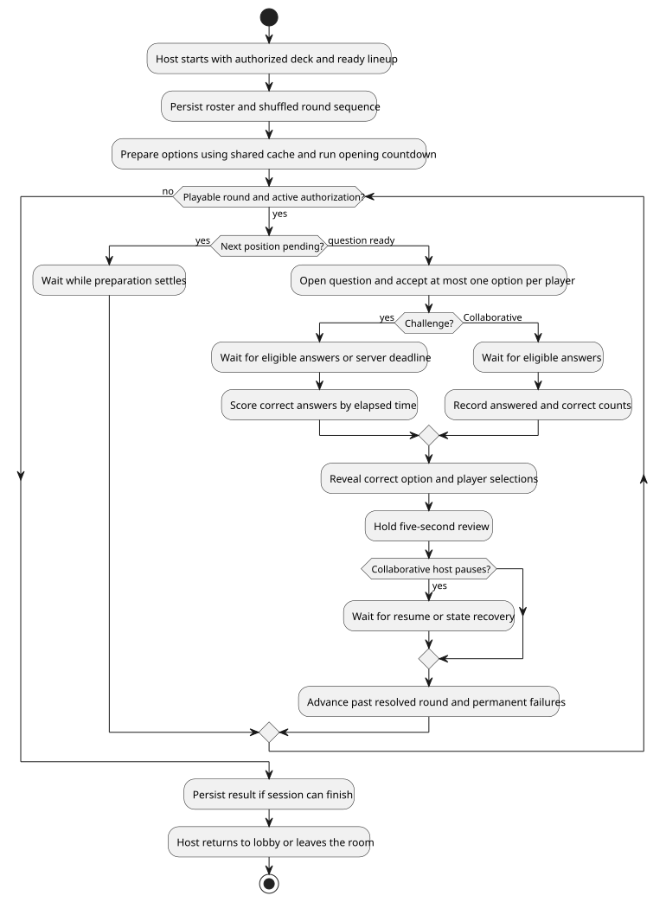
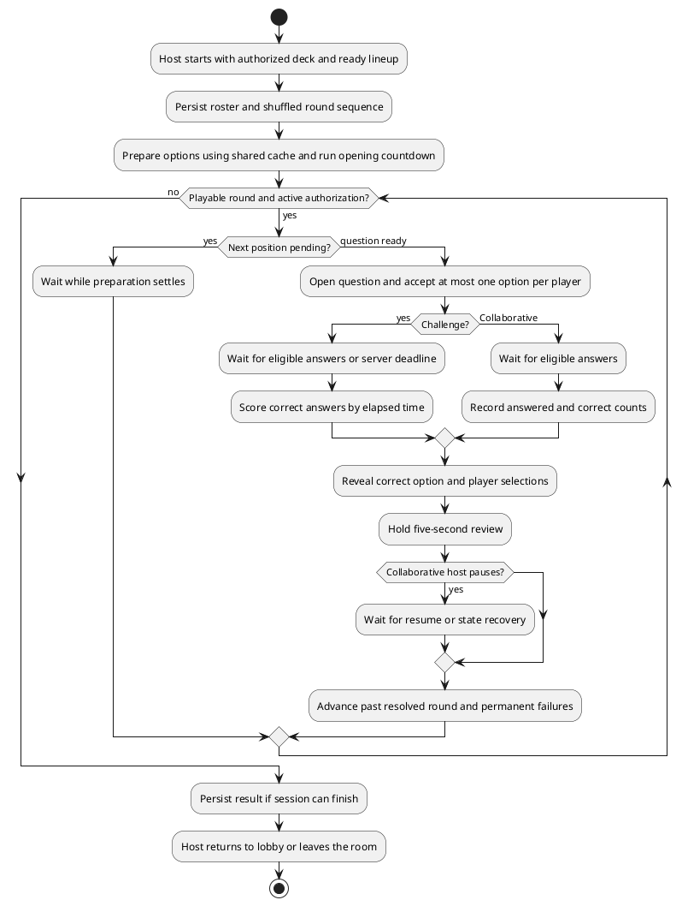
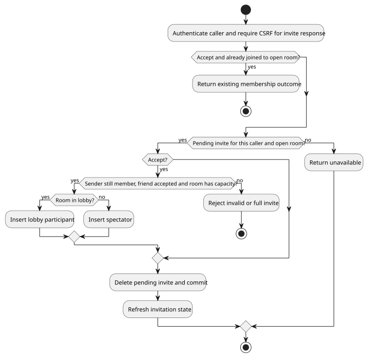
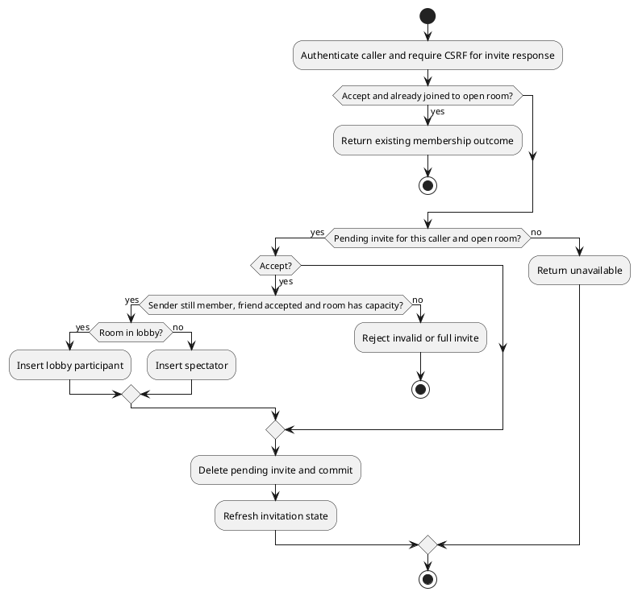

# Activity diagrams · Study Rooms

[Architecture index](../../README.md) · [Study Rooms](../../06-multiplayer-study-rooms.md)

## Collaborative and Challenge gameplay

The engine may finish early when the deck grant is lost or no eligible players remain. A pending position never runs an answer timer. The client draws the reveal using a committed viewer-specific snapshot.

Sources [lobby checks](../../../../backend/app/services/study_rooms.py), [round engine](../../../../backend/app/services/room_study.py), [room view](../../../../frontend/src/views/RoomView.vue).

## Room joining and invitation validation

An accepted friend invitation is necessary for new membership. The server validates against the current database when the invite is used. A requester can decline an open invite even when the sender would no longer qualify for acceptance.

Sources [room invite response](../../../../backend/app/services/study_rooms.py), [CSRF and route](../../../../backend/app/auth/middleware.py), [Room API](../../../../backend/app/routers/study_rooms.py).
