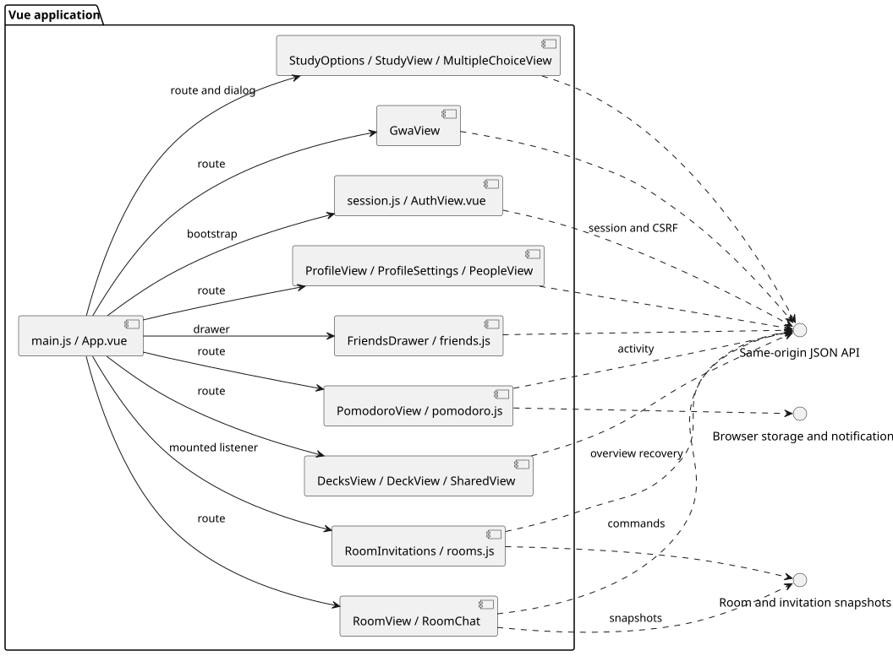
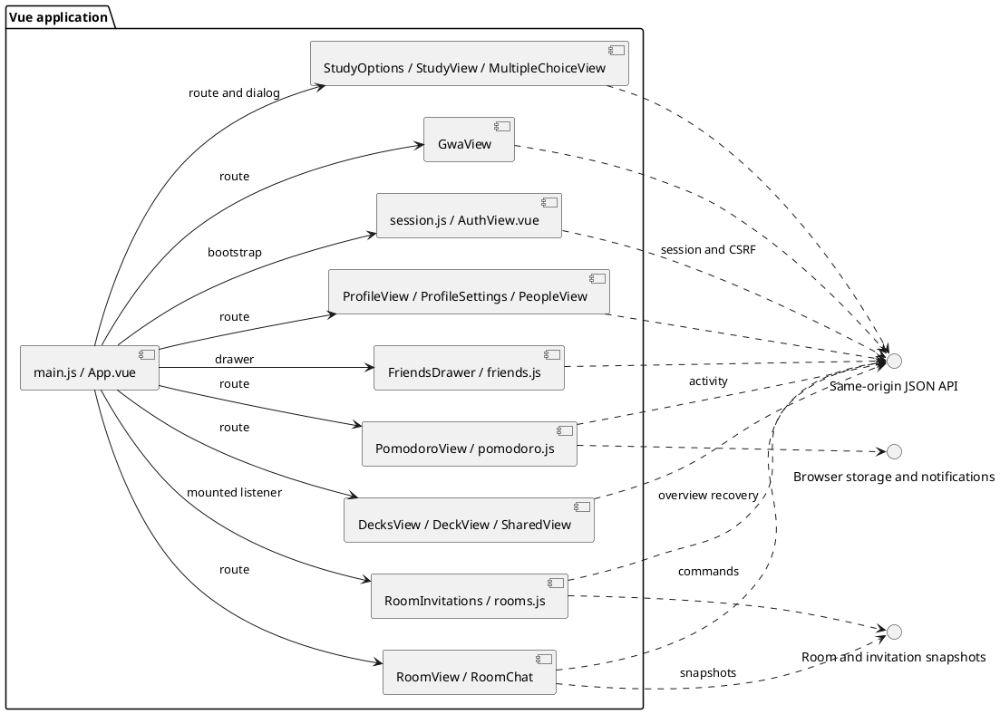
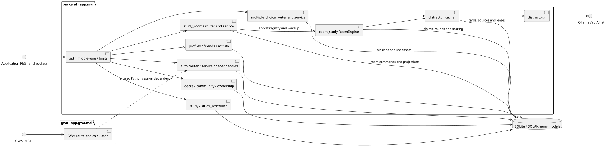
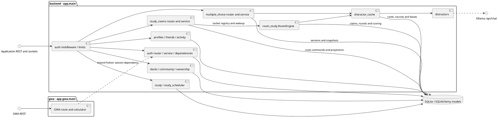

# UML components

[Architecture index](../README.md) · [Component responsibilities](../02-architecture-and-components.md)

## Browser components

The root shell mounts notifications and shared UI. The Vue Router selects feature views. Session bootstrap supplies authenticated identity and CSRF to same-origin requests. Room socket transport lives in `rooms.js`. Pomodoro's clock runs in the browser.

Sources [Vue entrypoint](../../../frontend/src/main.js), [root shell](../../../frontend/src/App.vue), [session](../../../frontend/src/services/session.js), [room transport](../../../frontend/src/services/rooms.js), [Pomodoro](../../../frontend/src/services/pomodoro.js).

## Backend components

The boxes group real Python files by responsibility. GWA imports shared authentication code inside its own process. It does not make network calls to the main backend. Notification snapshots use the room router and engine registry.

Sources [backend assembly](../../../backend/app/main.py), [room router](../../../backend/app/routers/study_rooms.py), [room engine](../../../backend/app/services/room_study.py), [cache](../../../backend/app/services/distractor_cache.py), [GWA API](../../../backend/app/gwa/main.py).
