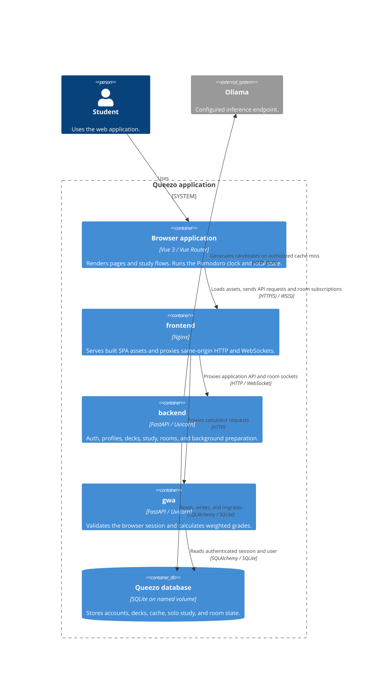

# C4 container view

[Architecture index](../README.md) · [Components](components.md) · [Deployment](deployment.md)

The browser handles untrusted entry points. Nginx is the default proxy trusted by private API listeners. Both API services open the same SQLite file on the mounted volume. Ollama sees card text only when the preparation path calls it. Development HMR and the optional backup overlay are shown in [deployment](deployment.md).

Sources [frontend entrypoint](../../../frontend/src/main.js), [Compose](../../../compose.yaml), [Nginx routing](../../../nginx/nginx.conf), [GWA entrypoint](../../../backend/app/gwa/main.py), [generator](../../../backend/app/services/distractors.py).
