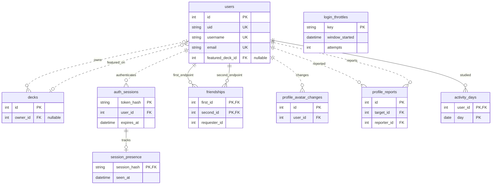
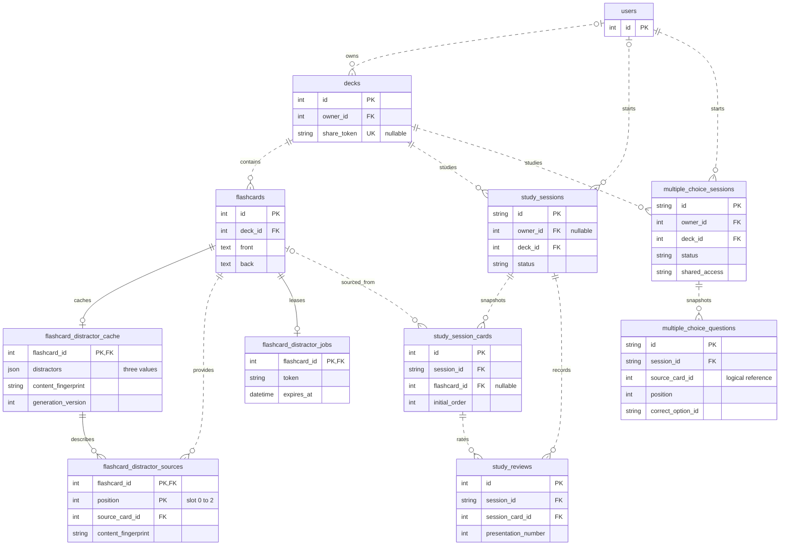
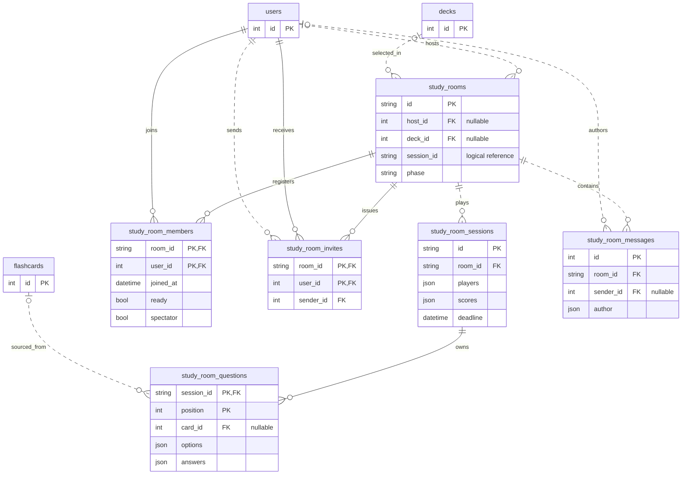

# Physical database ER

[Architecture index](../README.md) · [Table catalog](../03-database-design.md) · [Domain classes](domain-classes.md)

These diagrams identify physical primary and foreign keys in the initialized SQLite schema. Repeated entity names connect the subgraphs. Scalar attributes are selective. Solid lines denote identifying relationships, and dotted lines denote non-identifying relationships.

## Identity and account activity

Usernames and emails are case-insensitive unique keys. Friendship columns are the sorted participants, with the requester constrained to one endpoint. Reports have distinct reporter and target IDs. Rate-limit buckets use an independent key.

Sources [identity models](../../../backend/app/models.py), [legacy identity and profile migrations](../../../backend/app/profile_migration.py).

## Content, shared cache, and solo study

Classic snapshot order and review presentation identifiers are unique within a session. Solo Multiple-Choice positions and original card IDs are likewise unique within each session. Options and the correct option are recorded together. A missing live card does not remove its already prepared solo snapshot. SQLite triggers invalidate changed cache dependencies and enforce the 150-card cap.

Sources [models](../../../backend/app/models.py), [SQLite schema and baseline indexes](../../../backend/app/database.py).

## Multiplayer

Room and user form the member and invitation keys. Room-session ID and position identify a round. Player roster, submitted answers, and standings are stored JSON values, without individual answer rows. The service manages the current session and deck-owner grant as logical pointers.

Sources [room models](../../../backend/app/models.py), [lifecycle service](../../../backend/app/services/room_study.py).
