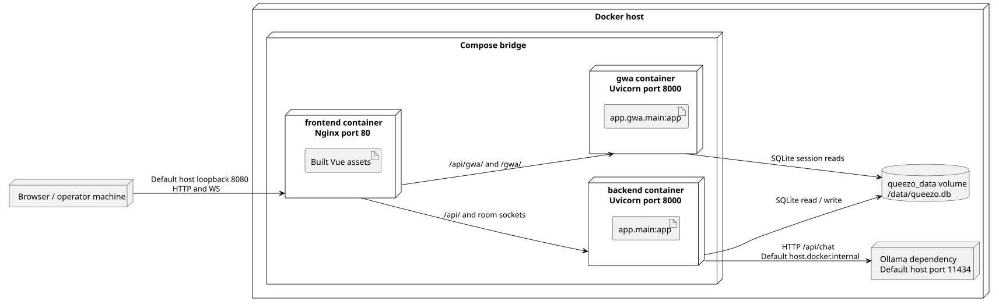
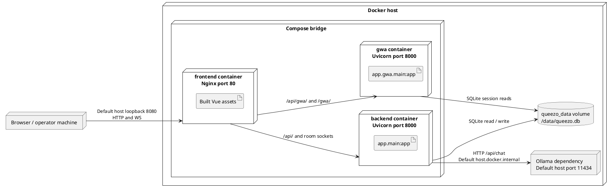
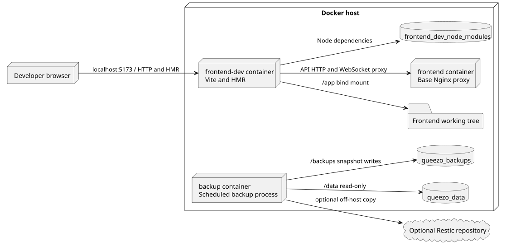
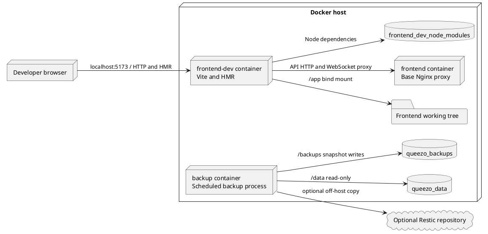

# UML deployment

[Architecture index](../README.md) · [Infrastructure](../07-deployment-and-infrastructure.md)

## Base Compose

Base Compose publishes Nginx on loopback. The backend and GWA ports are bridge-only. A deployment may terminate public HTTPS upstream. Neither that gateway nor a hosted instance is defined by the repository.

Sources [Compose](../../../compose.yaml), [frontend image](../../../nginx/Dockerfile), [backend image](../../../backend/Dockerfile), [Nginx config](../../../nginx/nginx.conf).

## Optional overlays

Development and backup are independent overlays. Development augments local-origin policy for both APIs. Backup stores SQLite snapshots on a separate volume and can copy them to an externally configured repository.

Sources [development overlay](../../../compose.dev.yaml), [Vite proxy](../../../frontend/vite.config.js), [backup overlay](../../../compose.backup.yaml), [runbook](../../production/DATABASE_RELIABILITY.md).
