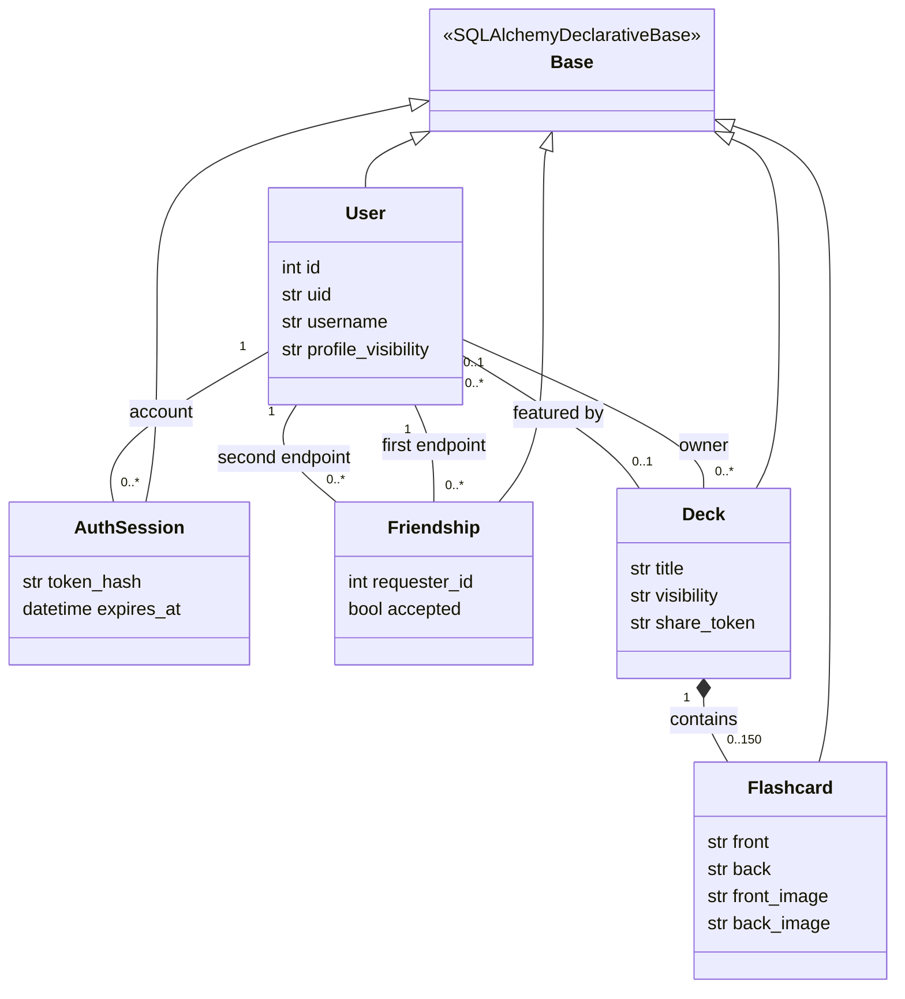
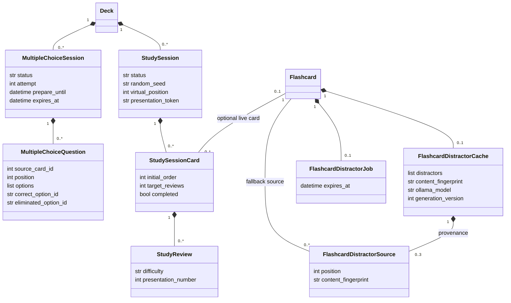
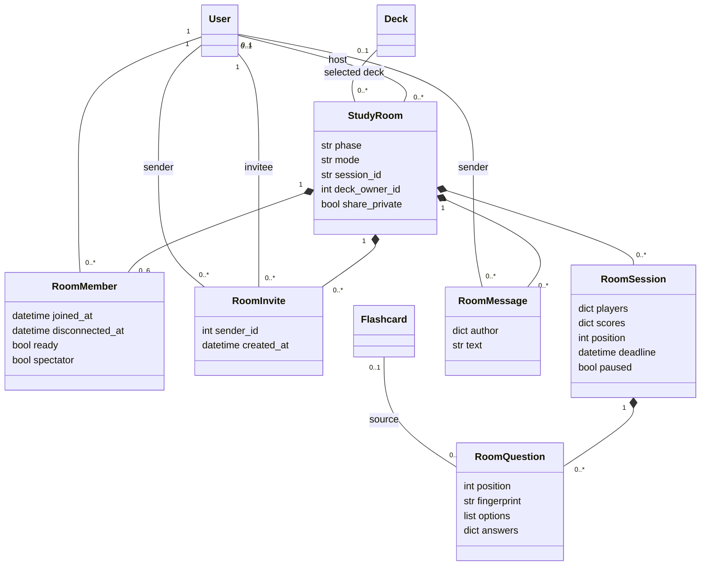

# UML domain classes

[Architecture index](../README.md) · [Physical ER](database-er.md)

## Accounts and content

Associations show domain and key constraints. They do not imply SQLAlchemy relationship properties. An active account owns every newly created deck. Nullable owner represents legacy rows. Featuring is an optional association with a public deck.

Source [models](../../../backend/app/models.py).

## Solo study and inference

Solo sessions own their question state. A cached choice may depend on another card's current content. A Multiple-Choice snapshot retains its source ID after deletion. The physical ER shows its lack of a foreign key to the live card.

Sources [models](../../../backend/app/models.py), [cache](../../../backend/app/services/distractor_cache.py).

## Study Rooms

Room membership models participant identity. The six-member maximum is a service constraint. A session belongs to one room, and the room's current-session pointer selects which session is active. Prepared questions contain answer data indexed by player identity in JSON.

Sources [models](../../../backend/app/models.py), [membership and limits](../../../backend/app/services/study_rooms.py).
