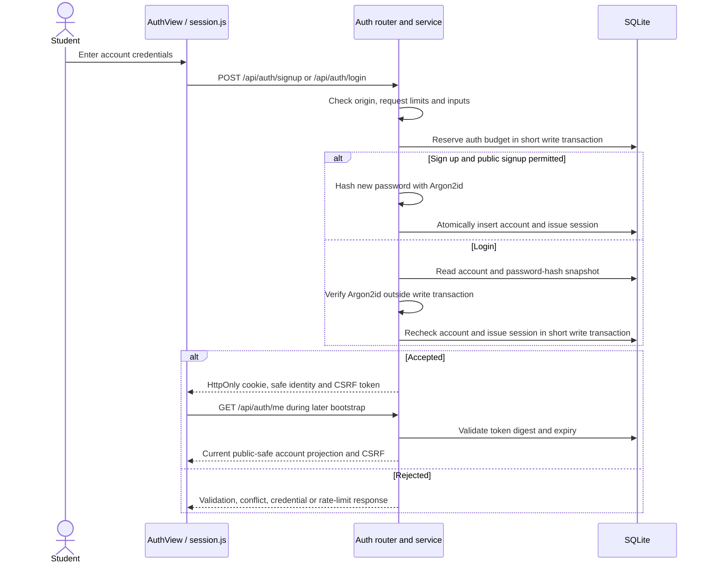
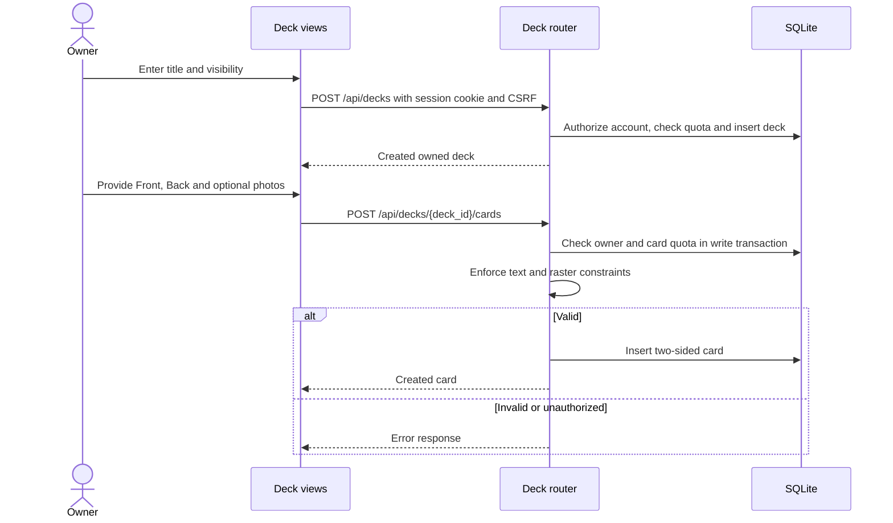
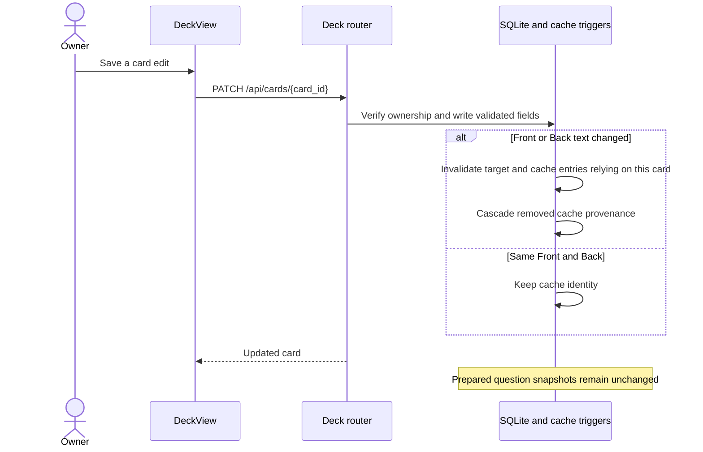

# Sequence diagrams · Accounts and card editing

[Architecture index](../../README.md) · [Security](../../04-authentication-and-security.md)

## Registration and login

Database uniqueness is authoritative for concurrent signups. Login performs dummy verification when appropriate and checks the original hash before committing a session. The browser keeps CSRF in memory. The raw session secret travels in the cookie.

Sources [auth routes](../../../../backend/app/auth/router.py), [service](../../../../backend/app/auth/service.py), [frontend session](../../../../frontend/src/services/session.js).

## Deck and card creation

Deck creation defaults to private. Each new card is eligible for later inference, but creation has no inference dependency. Validation also runs at API schema boundaries.

Sources [owned deck routes](../../../../backend/app/routers/decks.py), [input schemas](../../../../backend/app/schemas.py), [image validation](../../../../backend/app/services/card_images.py).

## Edit and invalidate

The trigger invalidates dependencies in the same committed write. A generator that started before the edit cannot publish the old choices because it rechecks the card fingerprint and lease.

Sources [card editing](../../../../backend/app/routers/decks.py), [triggers](../../../../backend/app/database.py), [cache publication](../../../../backend/app/services/distractor_cache.py).
