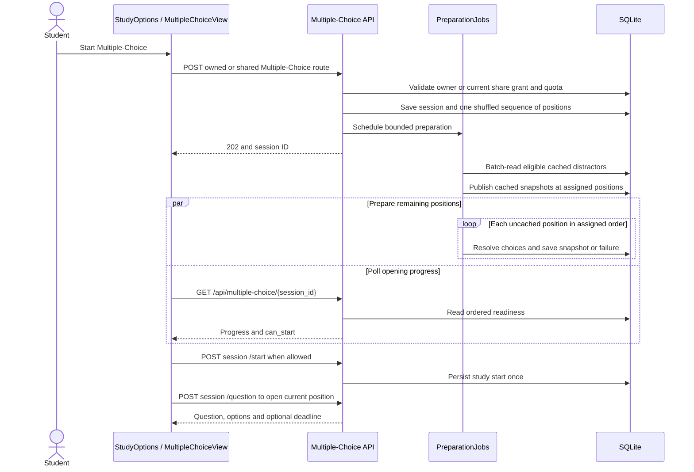
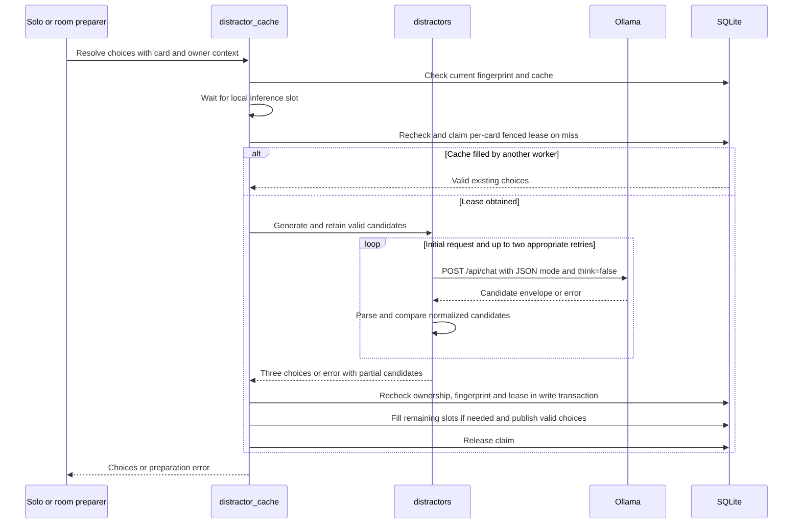
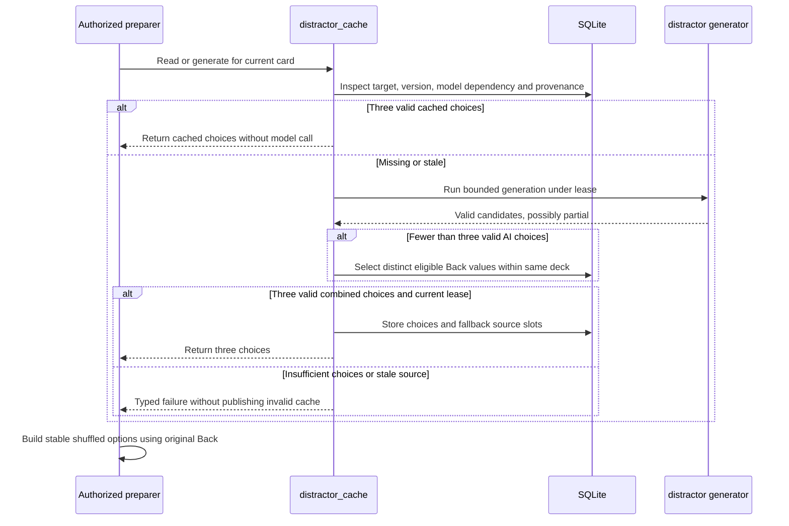

# Sequence diagrams · Solo study and AI

[Architecture index](../../README.md) · [Flashcards and AI](../../05-flashcards-and-ai.md)

## Solo session initialization

Progress polling and question opening are distinct. Published cache hits may occupy later positions. They do not change the ordered opening threshold or the question the learner receives. Preparation can continue during study.

Sources [MCQ routes](../../../../backend/app/routers/multiple_choice.py), [preparation and projections](../../../../backend/app/services/multiple_choice.py), [Vue view](../../../../frontend/src/views/MultipleChoiceView.vue).

## Generation and persistence

The initial structured request targets six candidates. The retry policy can vary candidate count and instructions. A running inference request does not hold the SQLite write transaction. Publication is fenced against stale workers.

Sources [Ollama generator](../../../../backend/app/services/distractors.py), [cache and fenced claims](../../../../backend/app/services/distractor_cache.py).

## Cache hit and fallback

A pure deck-derived cache survives a model change. Mixed choices depend on the current model and the recorded fallback sources. Normalized text checks cannot establish semantic correctness.

Sources [cache rules and fallback](../../../../backend/app/services/distractor_cache.py), [solo consumer](../../../../backend/app/services/multiple_choice.py), [room consumer](../../../../backend/app/services/room_study.py).
