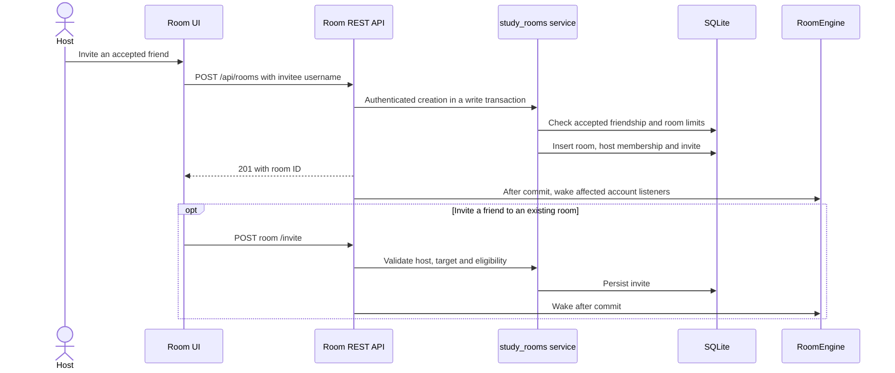
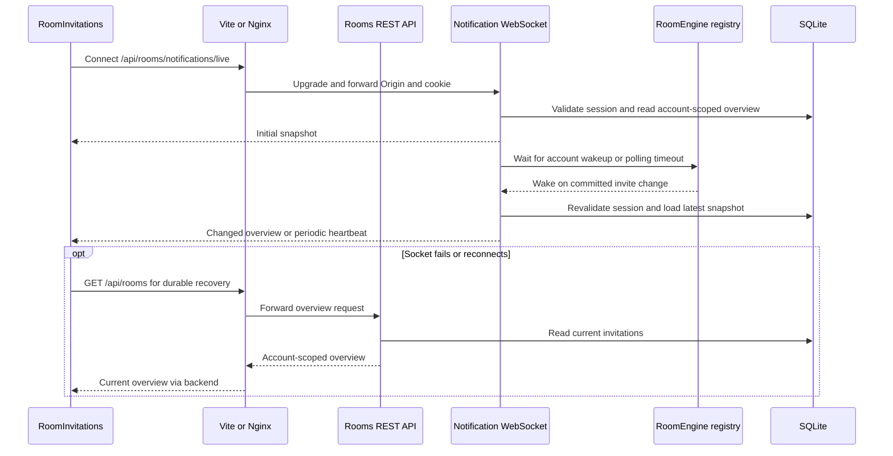
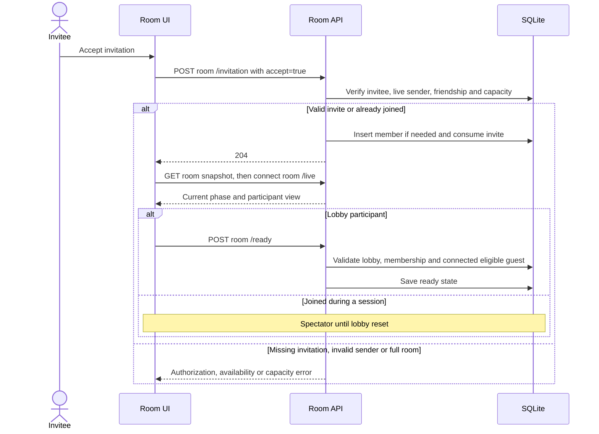
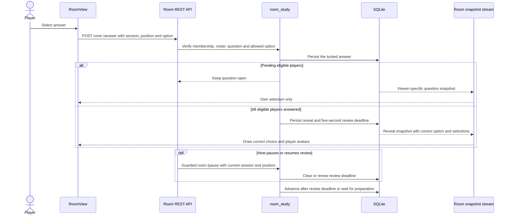
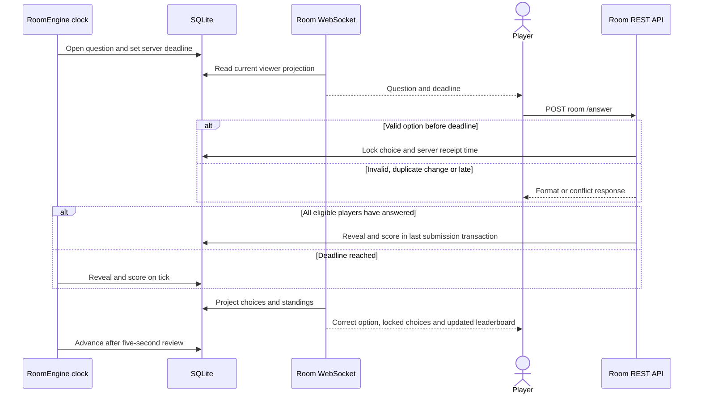
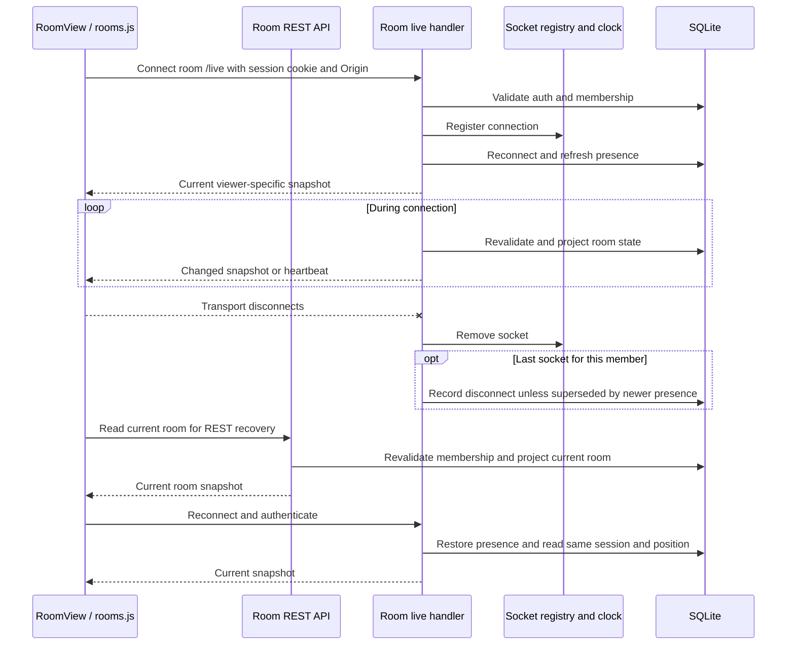
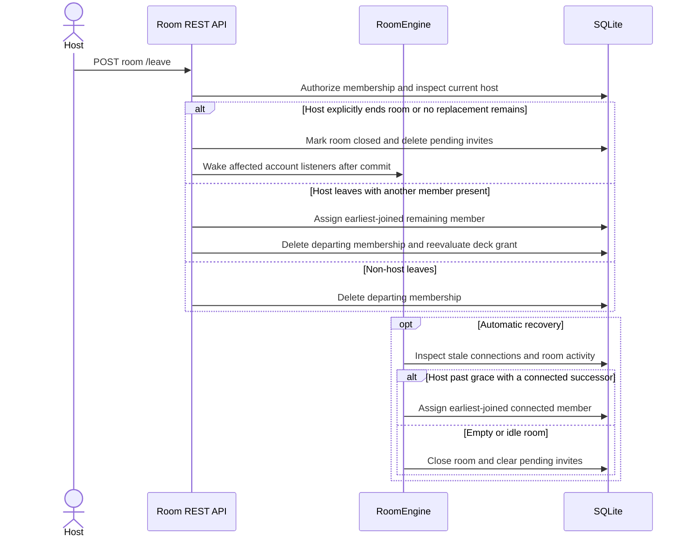

# Sequence diagrams · Study Rooms

[Architecture index](../../README.md) · [Study Rooms](../../06-multiplayer-study-rooms.md) · [State machines](../states/study-rooms.md)

## Room creation and invitation

The host must be authenticated and the invite targets an accepted friend. The notification wakeup follows a committed write. Pending invites can be rediscovered through the durable overview.

Sources [routes](../../../../backend/app/routers/study_rooms.py), [creation and eligibility](../../../../backend/app/services/study_rooms.py).

## Live invitation delivery

The browser receives snapshots for its own account. The process-local wakeup reduces latency. The polling fallback and REST fetch do not depend on the wakeup reaching an existing socket.

Sources [notification handler](../../../../backend/app/routers/study_rooms.py), [room engine](../../../../backend/app/services/room_study.py), [Vue invitation component](../../../../frontend/src/components/RoomInvitations.vue).

## Join and readiness

The host selects settings separately. Starting requires a connected host and enough connected, ready players. Mid-session participants cannot enter the persisted player roster.

Sources [join and readiness routes](../../../../backend/app/routers/study_rooms.py), [authorization and roster](../../../../backend/app/services/study_rooms.py).

## Collaborative submission and reveal

The final accepted submission can trigger reveal in the same transaction. The clock also reevaluates eligibility. Collaborative mode has no answer deadline. Review pause is a host action distinct from answering.

Sources [answer and pause routes](../../../../backend/app/routers/study_rooms.py), [round state and projection](../../../../backend/app/services/room_study.py).

## Challenge timer and scoring

For correct answers, points decay from 1,000 with elapsed time and floor at 100. Wrong or absent answers earn zero. The server owns receipt time, deadlines and scoring. Frame timing does not grant additional answer time.

Source [round execution and scoring](../../../../backend/app/services/room_study.py).

## WebSocket disconnection and reconnection

The database retains the round. A dropped socket starts a grace period. If the player stays away, the engine reevaluates eligibility and can hand off a disconnected host. Another valid tab can keep membership connected.

Sources [room socket and disconnect handling](../../../../backend/app/routers/study_rooms.py), [client transport](../../../../frontend/src/services/rooms.js), [clock and host handling](../../../../backend/app/services/room_study.py).

## Host handoff and termination

The explicit and automatic handoff paths use different eligibility rules. Private-deck access depends on the owner remaining in the room. A revoked grant can end the active session. Closed rooms are unavailable to normal membership reads.

Sources [leave route](../../../../backend/app/routers/study_rooms.py), [join-order, closure and grant](../../../../backend/app/services/study_rooms.py), [automatic recovery](../../../../backend/app/services/room_study.py).
