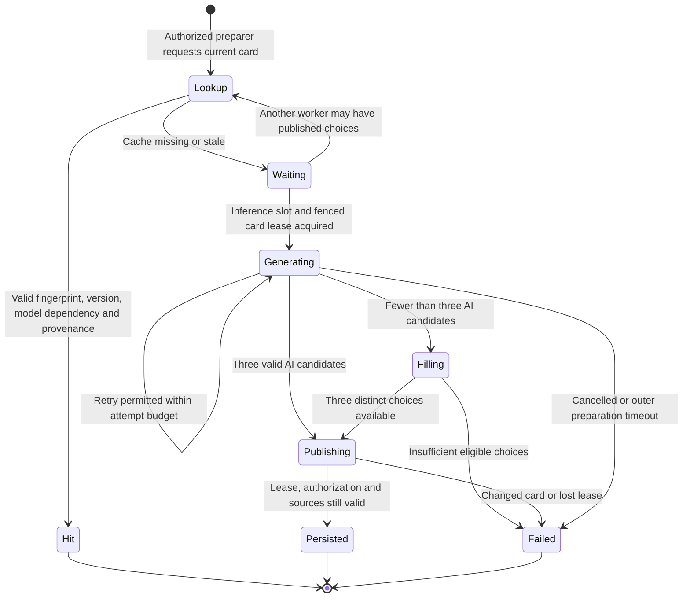

# State machine · Shared distractor preparation

[Architecture index](../../README.md) · [Flashcards and AI](../../05-flashcards-and-ai.md)

These are workflow states. The database stores a valid result row and a separate expiring lease, without a distractor-status enum. Front/Back edits, deletion of a card or dependency, or incompatible generation identity make future lookups miss. Hard worker failure is bounded by lease expiry.

Sources [generation](../../../../backend/app/services/distractors.py), [lease, lookup, and publication](../../../../backend/app/services/distractor_cache.py), [invalidation triggers](../../../../backend/app/database.py).
