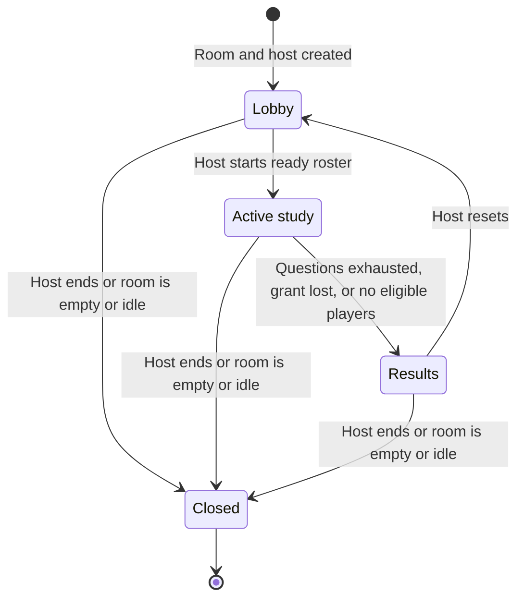
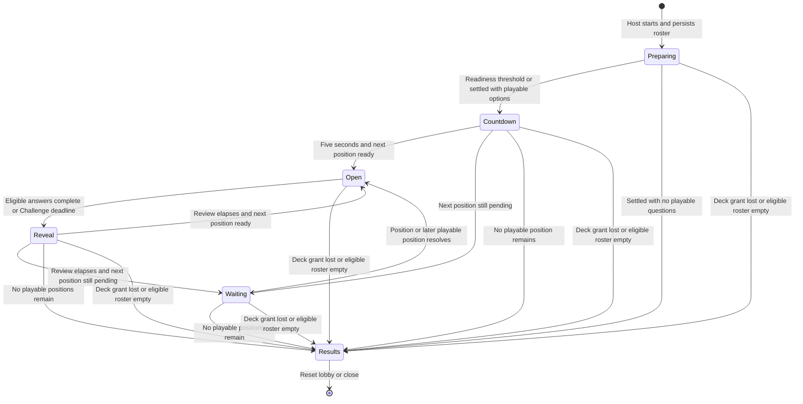
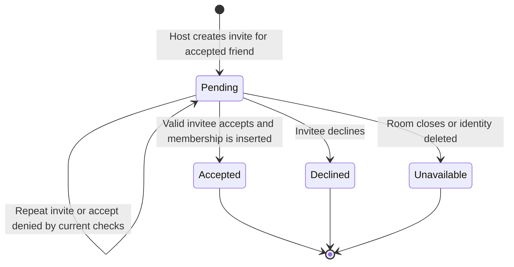
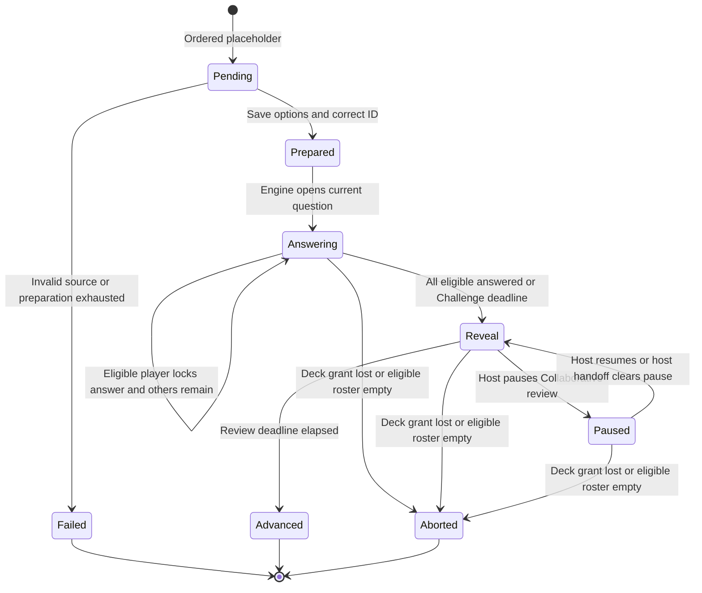

# State machines · Study Rooms

[Architecture index](../../README.md) · [Study Rooms](../../06-multiplayer-study-rooms.md)

## Room lifecycle

Active study groups five persisted room phases. Host handoff can occur within an existing phase. Closure hides the room from membership reads and clears outstanding invites. Closed rows are retained.

Sources [membership, closure, and reset](../../../../backend/app/services/study_rooms.py), [clock](../../../../backend/app/services/room_study.py).

## Multiplayer session lifecycle

The phases come from the owning room's `phase`. `RoomSession` stores the active position, deadlines, claims, and result data. Closure can stop any phase, as shown in the room lifecycle above. Preparation continues while rounds play, and permanent failures are skipped by ordered advancement.

Sources [round progression](../../../../backend/app/services/room_study.py), [room lifecycle](../../../../backend/app/services/study_rooms.py).

## Invitation lifecycle

Only the pending invite is a persisted invite record. Acceptance creates membership and deletes that record. Decline and cleanup also remove it. A lost friendship or sender membership can prevent acceptance while the row stays pending.

Sources [invite create, join and close](../../../../backend/app/services/study_rooms.py), [FK deletion rules](../../../../backend/app/models.py).

## Individual round lifecycle

These round states are derived from persisted options, failure, answers, room phase, and session clocks. Failed questions cannot open. The server records one option per eligible player and grants no scoring credit for a missing answer.

Sources [question model](../../../../backend/app/models.py), [round methods](../../../../backend/app/services/room_study.py), [pause route](../../../../backend/app/routers/study_rooms.py).
