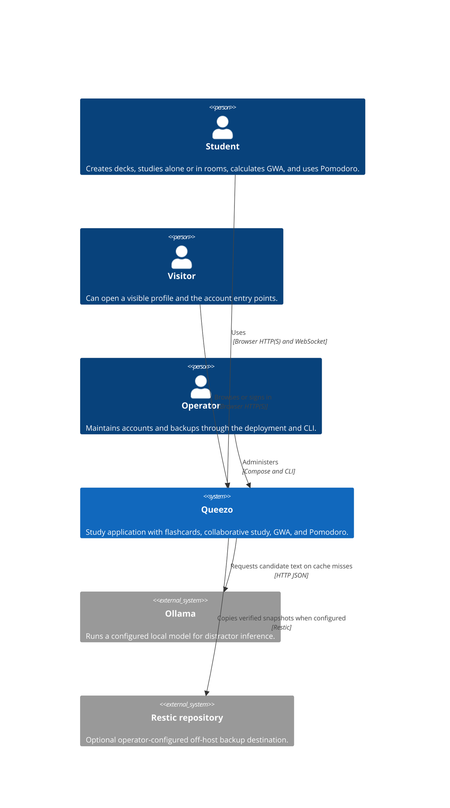

# C4 system context

[Architecture index](../README.md) · [Containers](container-architecture.md)

A student may act as a host, participant, or spectator in a particular room. Those roles derive from membership and session history. The operator uses administrative commands without a separate in-app operator role. Ollama and the optional off-host repository are outside the application boundary.

Sources [overview](../01-system-overview.md), [application assembly](../../../backend/app/main.py), [CLI](../../../backend/app/cli.py), [recovery runbook](../../production/DATABASE_RELIABILITY.md).
